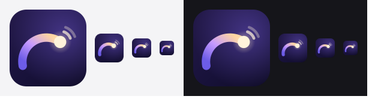

<p align="center">
  
</p>

<h1 align="center">ui-for-people</h1>

<p align="center">
  <b>A Claude Skill for emotional design.</b><br>
  Make products that <i>feel</i> good — not just products that work.<br>
  Distilled from one source: Tim Gabe's <i>“The Secret Behind Weirdly Addictive Apps”</i>.
</p>

<p align="center">
  
</p>

---

> **Note on language.** The skill itself is written in **Spanish** — it was built for a
> Spanish-speaking team. Claude reads and applies it in any language: ask in English and you get
> English back. This README is bilingual; everything else under `/` is Spanish.
>
> **Nota sobre el idioma.** La skill está escrita **en español**. Este README es bilingüe (inglés
> primero, para que se encuentre); el resto del repositorio está en español.

---

# English

## What it is

`ui-for-people` is a [Claude Skill](https://docs.claude.com/en/docs/claude-code/skills) — a
packaged procedure Claude loads when it's relevant. It follows the
[Agent Skills](https://agentskills.io/) open standard, so it also works in other tools that
implement it.

It encodes **emotional design**: the practice of making a product feel engaging, personal and
alive, rather than merely functional.

**The thesis**, straight from the source: now that anyone can ship fast — APIs, no-code, AI models
— being useful is no longer enough. When every product has the same access to technology, the
durable edge isn't the code or the features. It's **how your product makes people feel when they
open it, and how it leaves them when they close the tab**. Or as Reed Hastings put it: *“The
product has to be so good people want to talk about it.”*

## What's actually in it

**11 principles**, taken verbatim from the three case studies the video puts on screen, each
translated into "what this looks like in practice":

| Case | Product type | Principles |
|---|---|---|
| **Duolingo** | Habit products | `instant emotional feedback` · `celebrate small wins` · `use character expressions` · `progress animations` |
| **Phantom** | Products that have to earn trust (finance, crypto, health, insurance) | `polish builds trust` · `keep it approachable` · `build for people, not just pros` · `performance < product feel` |
| **Revolut** | Premium products | `nail the first impression` · `add moments of delight` · `make interactions feel dynamic` |

Plus the part most "delight" advice skips — **the hard rule**:

> **“None of these design details shout at you.”**

Which the skill turns into a four-question rejection filter: can a user *name* it? does it
*block*? does it *say* anything? does it *repeat* until it's noise? Anything that fails gets
deleted, not toned down. No confetti on everything. No delight that gets in the way.

It also ships:

- a **5-step procedure** (classify the product → find the five moments → run the checklist → apply
  the filter → say what you rejected and why);
- a **cross-reference table**: which principles govern which kind of product;
- **before/after examples** written as code or UI description;
- an explicit **"what this skill does NOT cover"** section, so it never passes off generic UX
  advice as coming from the source.

## Install

### Claude Code

Personal (every project on your machine):

```bash
git clone https://github.com/w-avw/ui-skill-for-people.git ~/.claude/skills/ui-for-people
```

Project (committed, so your team gets it too) — from the repo root:

```bash
git clone https://github.com/w-avw/ui-skill-for-people.git .claude/skills/ui-for-people
```

Restart the session, or run `/ui-for-people` to invoke it directly. Claude also loads it on its own
whenever the conversation is about designing or reviewing an interface.

### Claude Desktop / claude.ai

1. Enable code execution: **Settings → Capabilities → Code execution and file creation**.
   (Team/Enterprise: an owner must enable **Skills** in *Organization settings → Plugins & skills →
   Policy*.)
2. Zip the skill folder — the folder inside the zip must be named `ui-for-people`:
   ```bash
   zip -r ui-for-people.zip ui-for-people
   ```
3. **Customize → Skills → `+` → “+ Create skill” → “Upload a skill”**, and upload the zip.
4. Toggle it on.

## Using it

It triggers on its own. You can also just ask:

```
/ui-for-people  review the onboarding of this app
```

```
This empty state feels generic. Fix it without it shouting.
```

```
We're adding streaks. Which of the 11 principles apply, and what should we NOT do?
```

```
Go through this checkout flow: it's a payment, so trust comes first.
```

```
Is this animation worth it? Run it through the filter.
```

What you get back is a verdict with reasons — including what it threw out and why, which is where
most of the value sits.

## Credit

Everything here comes from one video. Watch it:

**[“The Secret Behind Weirdly Addictive Apps”](https://www.youtube.com/watch?v=Du2lkZ_cux8)** by
**[Tim Gabe](https://www.youtube.com/@timgabe)** — 2025-05-28, 12 min.

This repository is an unofficial, independent adaptation. It is not affiliated with or endorsed by
Tim Gabe, Duolingo, Phantom or Revolut. Those brands are named because the video analyses them;
nothing here uses their assets.

Referenced *by the video*, and flagged as such inside the skill rather than presented as its own
teaching: Don Norman, *Emotional Design*.

## Topics

`claude-skill` `claude-skills` `claude-code` `agent-skills` `anthropic` `ui-design` `ux-design`
`ui-ux` `emotional-design` `product-design` `design-principles` `design-system`
`microinteractions` `motion-design` `onboarding` `mobile-ui` `frontend` `design-review`
`ai-agents` `llm-tools`

(Also in [`.github/topics.txt`](.github/topics.txt), ready to apply with `gh`.)

## License

[MIT](LICENSE). The skill's text is an original adaptation; the ideas belong to the video, which is
credited above.

---
---

# Español

## Qué es

`ui-for-people` es una [skill de Claude](https://docs.claude.com/en/docs/claude-code/skills): un
procedimiento empaquetado que Claude carga cuando viene al caso. Sigue el estándar abierto
[Agent Skills](https://agentskills.io/), así que también sirve en otras herramientas que lo
implementen.

Recoge el **diseño emocional**: hacer que un producto se sienta atractivo, personal y vivo, en vez
de solamente funcional.

**La tesis**, tal cual sale de la fuente: ahora que cualquiera construye rápido —APIs,
herramientas no-code, modelos de IA— ser útil ya no basta. Cuando todos los productos tienen el
mismo acceso a la tecnología, la ventaja duradera no es el código ni las funcionalidades: es **cómo
se siente tu producto cuando alguien lo abre, y cómo lo deja al cerrar la pestaña**. O, en palabras
de Reed Hastings: *«el producto tiene que ser tan bueno que la gente quiera hablar de él»*.

## Qué trae por dentro

**11 principios**, tomados literalmente de los tres casos que el vídeo pone en pantalla, cada uno
traducido a «cómo se ve esto en la práctica»:

| Caso | Tipo de producto | Principios |
|---|---|---|
| **Duolingo** | Productos de hábito | `instant emotional feedback` · `celebrate small wins` · `use character expressions` · `progress animations` |
| **Phantom** | Productos que tienen que ganarse la confianza (finanzas, cripto, salud, seguros) | `polish builds trust` · `keep it approachable` · `build for people, not just pros` · `performance < product feel` |
| **Revolut** | Productos premium | `nail the first impression` · `add moments of delight` · `make interactions feel dynamic` |

Y la parte que casi todos los consejos sobre «deleite» se saltan — **la regla dura**:

> **«None of these design details shout at you»** — ningún detalle grita.

Que la skill convierte en un filtro de rechazo de cuatro preguntas: ¿se puede *nombrar*?
¿*bloquea*? ¿*dice* algo? ¿se *repite* hasta volverse ruido? Lo que falle se borra, no se atenúa.
Nada de confeti por todo. Nada de deleite que estorbe.

Además trae:

- un **procedimiento de 5 pasos** (clasificar el producto → localizar los cinco momentos → aplicar
  la lista → pasar el filtro → decir qué se descartó y por qué);
- una **tabla de referencias cruzadas**: qué principios mandan según el tipo de producto;
- **ejemplos de antes/después** escritos como código o como descripción de UI;
- una sección explícita de **«lo que esta skill NO cubre»**, para que nunca cuele consejos
  genéricos de UX como si vinieran de la fuente.

## Instalación

### Claude Code

Personal (todos los proyectos de tu máquina):

```bash
git clone https://github.com/w-avw/ui-skill-for-people.git ~/.claude/skills/ui-for-people
```

De proyecto (se commitea, así la tiene todo el equipo) — desde la raíz del repo:

```bash
git clone https://github.com/w-avw/ui-skill-for-people.git .claude/skills/ui-for-people
```

Reinicia la sesión, o invócala directamente con `/ui-for-people`. Claude también la carga sola
cuando la conversación va de diseñar o revisar una interfaz.

### Claude Desktop / claude.ai

1. Activa la ejecución de código: **Settings → Capabilities → Code execution and file creation**.
   (En Team/Enterprise, un propietario tiene que activar **Skills** en *Organization settings →
   Plugins & skills → Policy*.)
2. Comprime la carpeta de la skill — dentro del zip, la carpeta debe llamarse `ui-for-people`:
   ```bash
   zip -r ui-for-people.zip ui-for-people
   ```
3. **Customize → Skills → `+` → «+ Create skill» → «Upload a skill»**, y sube el zip.
4. Actívala con el interruptor.

## Cómo se usa

Se dispara sola. También puedes pedírselo:

```
/ui-for-people  revisa el onboarding de esta app
```

```
Esta pantalla vacía se siente genérica. Arréglala sin que grite.
```

```
Vamos a añadir rachas. ¿Cuáles de los 11 principios aplican y qué NO hay que hacer?
```

```
Repasa este flujo de pago: es dinero, así que manda la confianza.
```

```
¿Vale la pena esta animación? Pásala por el filtro.
```

Lo que devuelve es un veredicto con razones — incluido qué descartó y por qué, que es donde está
casi todo el valor.

## Crédito

Todo esto sale de un solo vídeo. Míralo:

**[«The Secret Behind Weirdly Addictive Apps»](https://www.youtube.com/watch?v=Du2lkZ_cux8)**, de
**[Tim Gabe](https://www.youtube.com/@timgabe)** — 28/05/2025, 12 min.

Este repositorio es una adaptación independiente y no oficial. No está afiliado ni respaldado por
Tim Gabe, Duolingo, Phantom ni Revolut. Esas marcas se nombran porque el vídeo las analiza; aquí no
se usa ningún recurso suyo.

Referencia que hace **el vídeo**, y que dentro de la skill se marca como tal en vez de presentarse
como enseñanza propia: Don Norman, *Emotional Design*.

## Estructura

```
ui-for-people/
├── SKILL.md                      la skill: tesis, procedimiento, los 11 principios,
│                                 la regla dura, las trampas y antes/después
├── references/
│   ├── fuente.md                 la fuente rótulo a rótulo, para poder verificarla
│   └── antes-despues.md          un antes/después por principio, y un "después" que está mal
├── assets/
│   ├── icon.svg                  el icono, original
│   ├── icon.png                  512 px
│   ├── icon-128.png              128 px
│   └── icon-tamanos.png          prueba de legibilidad en pequeño
├── .github/topics.txt            los topics de GitHub, listos para aplicar
├── LICENSE                       MIT
└── README.md                     este archivo
```

## Licencia

[MIT](LICENSE). El texto de la skill es una adaptación original; las ideas son del vídeo, que está
acreditado arriba.
